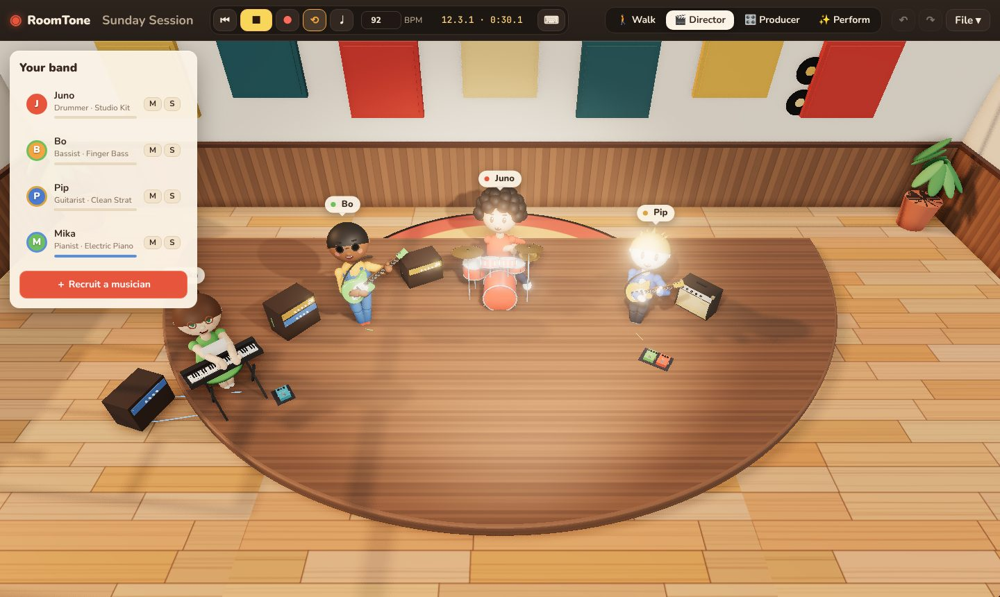
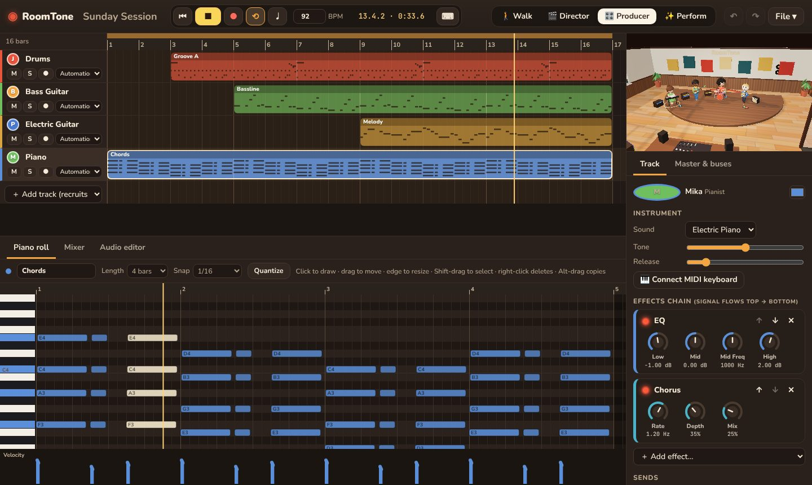
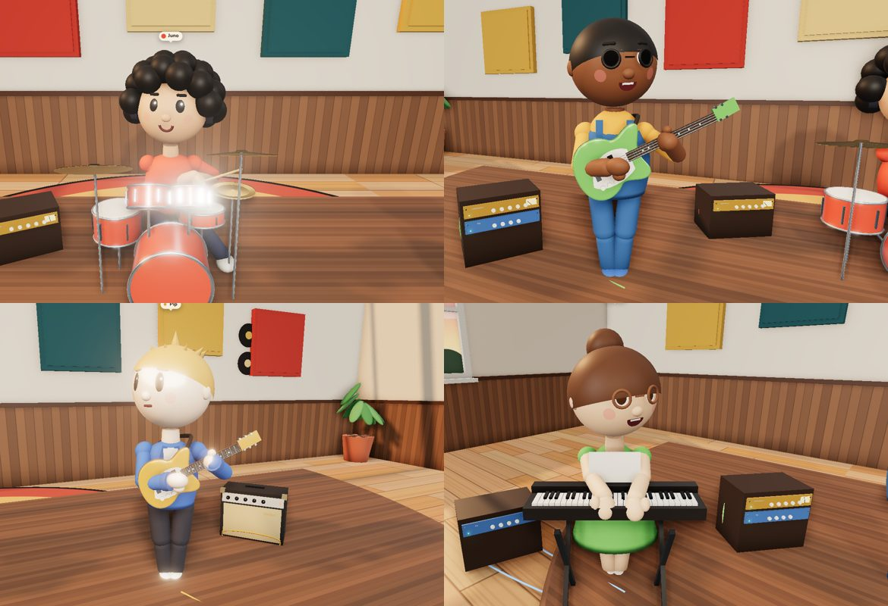
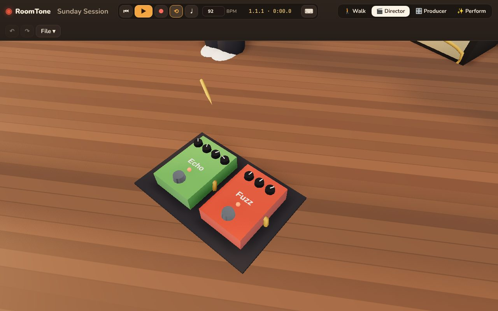
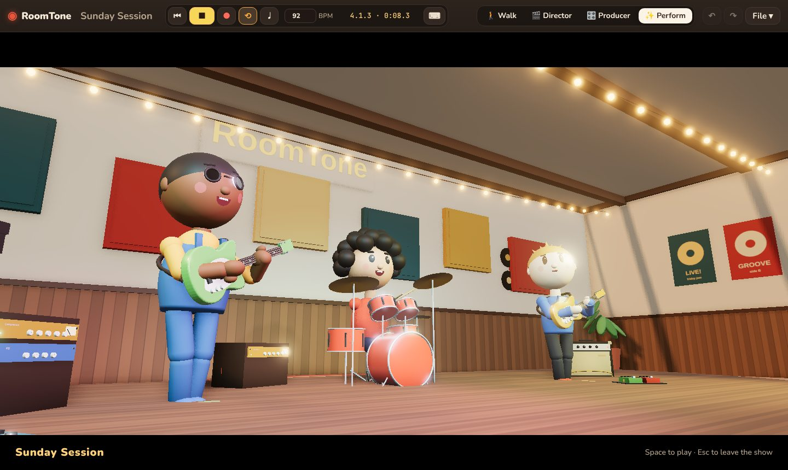

# RoomTone — a living 3D DAW

RoomTone is a music production app where your tracks are musicians in a cozy miniature recording studio.
Adding an instrument recruits a musician, effects are real pedals, rack units and amps you can turn by hand,
and the band plays the notes you write, in time with the audio.



| Producer view (full DAW) | Musicians playing actual MIDI |
| --- | --- |
|  |  |
| **Effects are physical gear** | **Performance mode** |
|  |  |

## Run it

```bash
cd roomtone
npm install
npm run dev        # http://localhost:5180  (add ?demo to ignore the autosave and load the demo song)
```

```bash
npm test           # unit tests (scheduler maths, undo/redo)
npm run build      # typecheck + production bundle in dist/
```

Press **Space** to play. The demo song, *Sunday Session*, is a 16-bar groove for drums, bass, guitar and electric piano.

## Four perspectives, one project

All views share the same project state and audio engine; switching never interrupts playback.

| View | Key | What it's for |
| --- | --- | --- |
| 🚶 Walk | `1` | First-person. Click to look around, WASD to walk. Look at any knob or fader and drag or scroll to turn it; click a footswitch to bypass a pedal; click a musician to open their panel. |
| 🎬 Director | `2` | Overhead view for running the band: name tags, mute/solo, recruit musicians, customise them. |
| 🎛️ Producer | `3` | Conventional DAW: arrangement, piano roll, mixer, audio editor, inspector, live studio preview. |
| ✨ Perform | `4` | Cinematic show: camera cuts on bar lines, follows whoever is loudest, stage lights pulse with the music. |

## What works today

| Area | Status |
| --- | --- |
| Sequencing | Multi-track MIDI clips that reference patterns (linked copies, *Make unique*), clips loop their pattern, loop region, tempo, snap, metronome |
| Piano roll | Draw, move, resize, box-select, Alt-drag copy, velocity lane, quantize, transpose, duplicate, drum names on drum tracks |
| Arrangement | Move/trim/resize clips, Alt-drag duplicate, move between tracks, double-click to create, drop audio files, automation lanes |
| Instruments | Synthesised drum kit, Karplus-Strong guitar and bass, additive piano, FM electric piano, organ, subtractive synth, sampler (load your own sample) |
| Audio | Import (drag & drop), microphone recording onto an armed audio track, waveform editor (normalize, reverse, fades, silence, crop), clip gain |
| Mixer | Volume, pan, mute, solo, meters with peak hold, sends to Reverb and Echo buses, master chain with limiter |
| Effects | EQ, compressor, reverb, delay, distortion, chorus, amp simulator — reorderable chains on tracks, buses and master |
| Automation | Volume, pan and every effect parameter, drawn in the arrangement; physical knobs and faders follow it |
| Physical studio | Pedals on a pedalboard, rack units in a tower, amps behind players, master rack, a mixing console mirroring every channel; signal cables glow with level |
| Musicians | Mii-proportioned characters on a shared Mixamo-named skeleton; hair, face, skin, outfit, colours, accessory, build, personality; saveable presets |
| Animation | Driven by scheduled note events: sticks strike the right drum, pianists press the right keys, guitarists fret and strum, vocalists' mouths follow the real signal level; idle fidgets, blinking, glances, waving at you |
| Project | Undo/redo for every edit (gestures are one step), autosave (localStorage + IndexedDB for audio), `.roomtone` project files with embedded audio, WAV export |
| Live input | Musical typing (Z–M and Q–U rows), Web MIDI controllers, MIDI recording into a new clip |

Not built yet (see [docs/ROADMAP.md](docs/ROADMAP.md)): native VST3 hosting, orchestral and electronic rooms,
music-video export, MIDI file import/export, tempo automation and time-stretching.

## Documentation

- [AGENTS.md](AGENTS.md) — rules and orientation for coding agents continuing this project
- [docs/ARCHITECTURE.md](docs/ARCHITECTURE.md) — modules, timing model, data flow, native-engine plan
- [docs/ROADMAP.md](docs/ROADMAP.md) — milestones
- [docs/ASSET_PIPELINE.md](docs/ASSET_PIPELINE.md) — characters, rigs, licensing research (LowPolyCrate, Quaternius, Mixamo)
- [docs/DEVELOPMENT.md](docs/DEVELOPMENT.md) — workflows, verification scripts, gotchas
